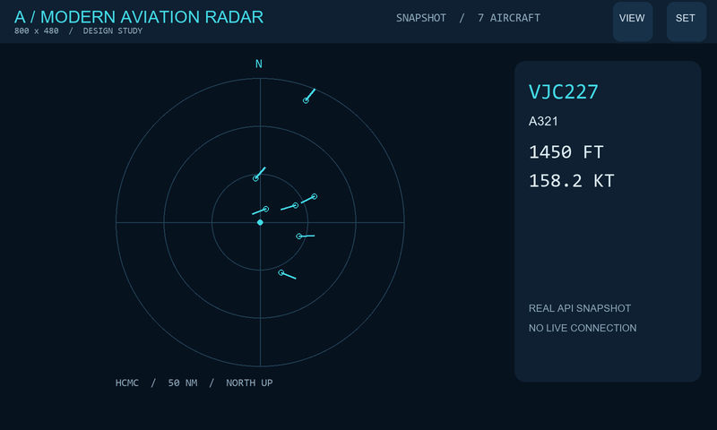
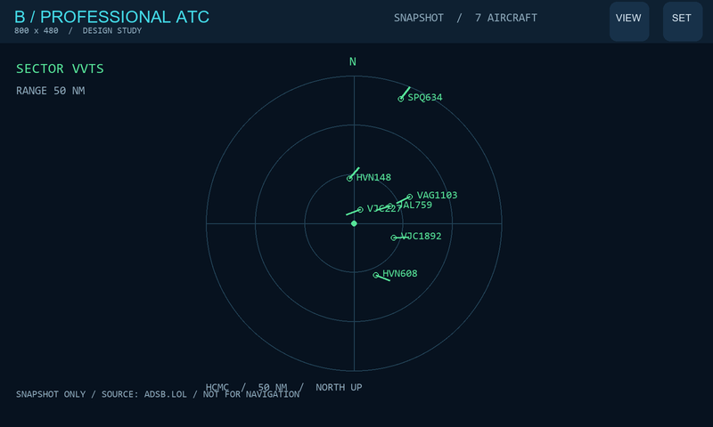
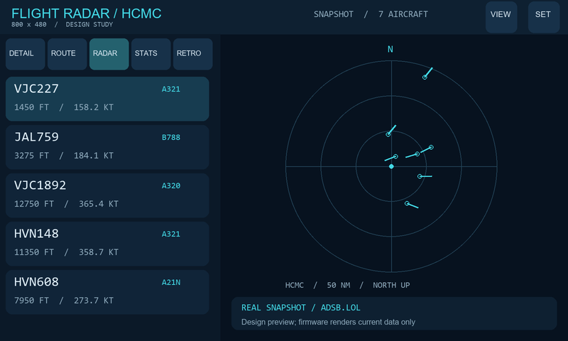

# UI 800×480 — ba concept và lựa chọn triển khai

## A — Modern Aviation Radar

Nền navy, radar cyan chiếm phần lớn diện tích, card chuyến bay bên phải. Tập trung vào một máy bay, ít nhãn, ít đường kẻ. Dễ nhìn nhưng không tiện so sánh nhiều chuyến bay cùng lúc.

## B — Professional ATC Radar

Radar ở trung tâm, range rings, callsign labels, heading vectors và thông tin sector. Độ tương phản tốt; nhiều mục tiêu gần nhau có thể chồng nhãn trên 800×480. Bản firmware giữ nguyên retro mode của tác giả để người dùng vẫn có phong cách radar cổ điển.

## C — Premium Flight Tracking Dashboard — được chọn

Giữ kiến trúc layout của tác giả: danh sách 310 px bên trái, nội dung 490 px bên phải và header 48 px. Bổ sung điều hướng trực tiếp 5 view, palette navy/cyan của A, card phẳng, font Inter cho thương hiệu và IBM Plex Mono cho callsign/số liệu. Không thêm canvas lớn hay animation trang trí để đạt layout này.

Các mockup trên có kích thước chính xác 800×480. Vị trí, callsign, type, altitude và speed dùng snapshot adsb.lol thật đã lưu trong `validation/adsb-lol-hcmc.json`; nhãn SNAPSHOT phân biệt với live. Không có máy bay giả được tạo cho firmware hoặc renderer. Phần bản đồ trong mockup là radar rings; firmware tiếp tục dùng tile workers/bản đồ gốc của tác giả.

## Nguyên tắc triển khai và kiểm chứng

- Giữ cả 5 views: detail/list, route map, geographic radar, statistics, retro; không thay networking hoặc thuật toán ADS-B bằng demo.
- Dùng 5 tab cao 44 px ở đầu danh sách; Settings và switch-mode có vùng chạm cao 44 px. Máy bay có vùng click mở rộng; khoảng cách/tọa độ chạm vẫn cần kiểm tra trên GT911 thật.
- Đồng hồ tách khỏi vùng weather/status, tránh các nhãn dài chồng nhau; long text bị cắt dấu chấm trong phần được giới hạn.
- Bảng dữ liệu giữ route unknown khi nguồn không có route; không suy ra hay bịa hành trình.
- Empty state hiển thị rõ `NO AIRCRAFT DATA`; fetch lỗi được đánh dấu stale trước khi loại mục tiêu cũ khỏi UI.
- Widget được tạo một lần. Text chỉ viết lại khi thay đổi; direct mode/dirty regions của LVGL được giữ. Không thêm gradient, shadow lớn hoặc hiệu ứng toàn màn hình.
- Font subset ASCII, degree/middle dot/em dash, OFL từ Google Fonts; font gốc của tác giả vẫn phục vụ các ngôn ngữ và icon. Flash budget phải kiểm tra bằng binary cuối, không suy từ kích thước source font.

Ảnh `baseline_view*.png` là framebuffer LVGL trước tùy biến. Ảnh `firmware-snapshot_view*.png` và `firmware-empty_view*.png` ghi nhận UI LVGL sau triển khai code, lần lượt với snapshot API thật và zero aircraft. Chỉ các ảnh có trong thư mục cùng log render PASS mới được tính là đã kiểm chứng. Renderer kiểm tra bố cục và logic UI trên host; không chứng minh RGB refresh, PSRAM bandwidth hay touch latency trên thiết bị.

QA: đã sửa nền của nhãn empty-state để range ring không vẽ qua chữ. Các ảnh cuối đều 800×480; năm view, zero data, ba tab Settings của host, 100 chu kỳ redraw và luồng HTTP lỗi đã được render/kiểm tra. Host Settings bỏ Wi-Fi bằng compile flag; không thay cho kiểm tra trên board.

Ảnh sử dụng snapshot [adsb.lol](https://www.adsb.lol/docs/open-data/api) theo [ODbL 1.0](https://opendatacommons.org/licenses/odbl/1-0/). Xem [nguồn và giấy phép](../ATTRIBUTIONS.md).
